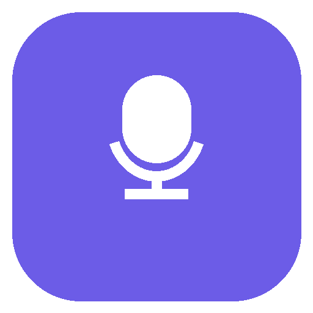
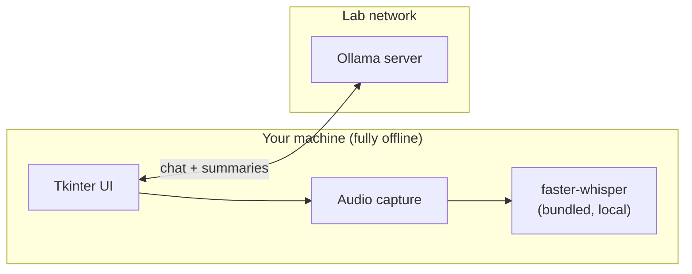

<div align="center">



# BrainLabLLM

**A private AI chat and meeting-notes assistant that runs entirely on lab hardware.**

[📖 Documentation](https://musallgroup.github.io/BrainLabLLM/) · [Installation](https://musallgroup.github.io/BrainLabLLM/getting-started/installation/) · [Troubleshooting](https://musallgroup.github.io/BrainLabLLM/troubleshooting/)

</div>

---

Chat with your lab's local language model, or record a meeting and get a full transcript plus an AI-generated summary — Key Points, Decisions, Action Items — with no audio or code ever leaving the building. Speech-to-text runs fully offline on your own machine; only chat and summarization talk to the lab's own server.

Built for people with zero coding experience: a double-click installer, no Python, no command line, no accounts.

## Features

- 💬 **Chat** with markdown/code rendering, conversation history, and file attachments
- 🔎 **Wiki lookup & web search** — opt-in, per-message tools that let the assistant fetch a page from the lab's internal wiki or search the public web, both staying on the lab network
- 🤖 **Agent tab** — an approval-gated coding assistant that can read, edit, and run commands in a project folder, showing every change before it happens
- 🎙️ **Meeting recording** with a locally-bundled speech-to-text model (GPU-accelerated, CPU fallback), or transcribe an existing audio/video file
- 🗣️ **Speaker identification** — labels who's talking in the transcript and summary (requires a GPU)
- ✨ **AI summaries** that scale to hour-long meetings via map-reduce summarization
- 📤 Export to plain text, or save into searchable chat history
- ⚙️ In-app settings — no config file editing needed for day-to-day use

See the full [documentation site](https://musallgroup.github.io/BrainLabLLM/) for installation, usage, configuration, and architecture details.

## Quick start

1. Get `BrainLabLLM_Setup_Package.zip` from your lab's distribution location.
2. Unzip it, run `BrainLabLLMSetup.exe`, click **Install**.
3. Done — no other setup required.

Full walkthrough: [Installation](https://musallgroup.github.io/BrainLabLLM/getting-started/installation/) · [Quick Start](https://musallgroup.github.io/BrainLabLLM/getting-started/quick-start/)

## For developers

```bash
conda create -n aider_env python=3.11 -y
conda activate aider_env
pip install requests sounddevice soundfile scipy numpy faster-whisper
python main.py
```

See [Building from Source](https://musallgroup.github.io/BrainLabLLM/development/building/) and [Packaging & Distribution](https://musallgroup.github.io/BrainLabLLM/development/packaging/) for the full developer guide, including how the installer is built.

## Project structure

```
main.py          Tkinter UI, chat networking, summarization
meeting.py       Audio recording + transcription (no UI dependency)
diarization.py   Speaker identification (no UI dependency)
agent.py         Coding-agent tool-calling loop (no UI dependency)
wiki.py          Lab wiki lookup tool (no UI dependency)
websearch.py     Public web search tool via local SearXNG (no UI dependency)
theme.py         Color palette + ttk.Style setup
installer.py     Standalone installer GUI
tests/           Automated pytest suite
docs/            This documentation site (MkDocs Material)
```

## Architecture at a glance



Full write-up, including why the app transcribes in one pass instead of live and why summarization uses map-reduce instead of refine-style: [Architecture](https://musallgroup.github.io/BrainLabLLM/architecture/).

---

<sub>Internal lab tool.</sub>
