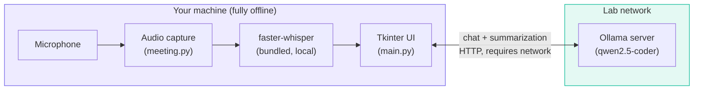
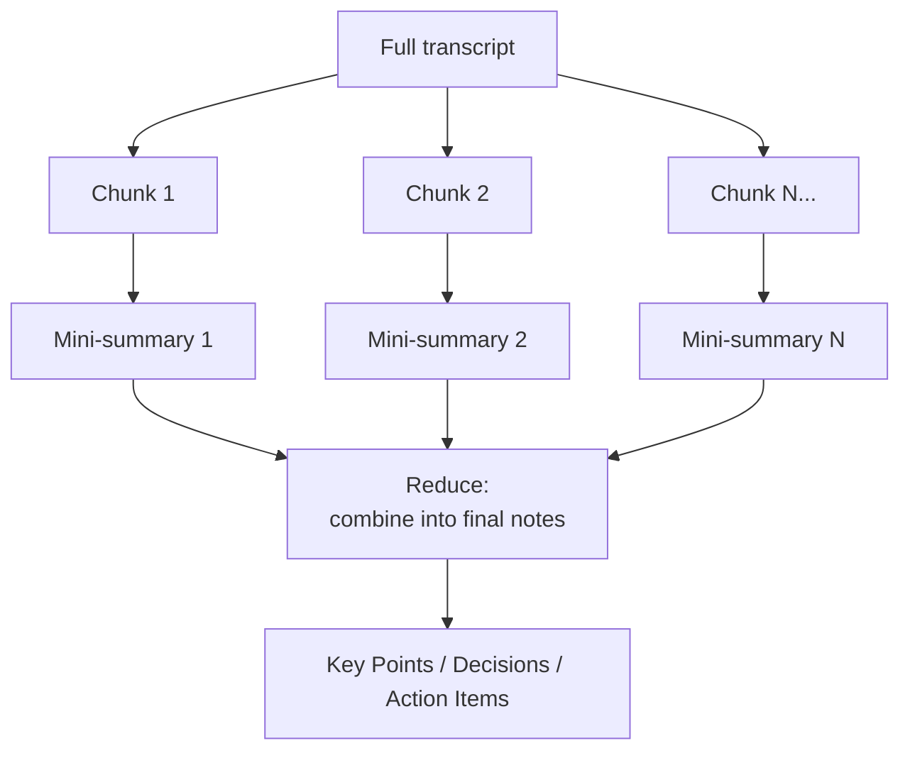

# Architecture

This page is for anyone maintaining, extending, or just curious about how the app is built. It documents not just *what* the system does, but *why* it's built this way — several design choices here came from things that didn't work in earlier iterations.

## System overview

Two AI workloads, running in two different places:

**Speech-to-text never leaves the machine.** Audio is captured, transcribed, and discarded locally — this is a deliberate privacy property, not an implementation detail. Only text (chat messages, transcripts being summarized) goes over the network, to the lab's own Ollama server.

## Module layout

| File | Responsibility |
|---|---|
| `main.py` | The Tkinter UI (`ChatApp`), configuration/settings persistence, chat networking (`query_ollama_stream`), and the map-reduce summarization logic. |
| `meeting.py` | Everything audio: device enumeration, recording (`AudioRecorder`), and the record-then-transcribe orchestrator (`MeetingSession`). No UI code and no dependency on `main.py`. |
| `theme.py` | Centralized color palette and `ttk.Style` configuration — the single source of truth for the app's visual design. |
| `installer.py` | A minimal, dependency-free Tkinter installer GUI, built separately from the main app (see [Packaging](development/packaging.md)). |

## Why batch transcription, not live { #why-batch-transcription }

An early version of the Meeting tab transcribed audio *while recording*, using a hand-rolled energy-threshold voice-activity detector (VAD) to chop continuous audio into utterances, transcribing each as it completed. This looked good in initial tests with clearly-paced, pause-separated speech.

Under real conditions — a person speaking quickly and continuously, the way people actually talk in meetings — it broke down in two specific ways:

1. **Fragmentation.** Natural micro-pauses (a breath, a half-second hesitation) were frequently mistaken for sentence boundaries, splitting one continuous thought into two disconnected fragments.
2. **Hallucination.** Very short, decontextualized audio clips are a known failure mode for Whisper-family models — with little context to work from, the model sometimes produced plausible-sounding but entirely fabricated text (a well-documented pattern; "Thank you for watching" on near-silent audio is a famous example of this class of error).

Tuning the VAD (longer silence thresholds, a debounce requiring sustained signal before committing to a segment, feeding the previous segment's text back in as context for the next) reduced but didn't eliminate the problem.

**The fix was architectural, not a bigger tuning pass**: record the entire meeting as one continuous buffer, and transcribe it *once*, using `faster-whisper`'s own built-in VAD filtering (`vad_filter=True`, backed by Silero VAD internally) — which is more sophisticated than the hand-rolled version, and critically, has the *entire recording's context* available when deciding where sentence boundaries actually are, rather than making that call in real time from a small rolling window.

The trade-off is explicit: no incremental transcript while recording, in exchange for a transcript that's reliably coherent. For meeting notes, that's the right trade.

## Summarization: map-reduce, not refine { #summarization }

A 60-minute meeting can produce a transcript well beyond what's comfortable to summarize in a single model call, and naive approaches to handling that have a specific, easy-to-miss failure mode worth documenting.

**Refine-style summarization** — repeatedly updating one running summary as new transcript arrives — has a well-known problem: each pass is dominated by whatever's newest, and details from early in the source material get diluted through repeated summarize-of-a-summary passes. Over many iterations, early decisions and action items can quietly disappear.

This app uses **map-reduce** instead:

1. **Map**: the transcript is split into chunks (by sentence boundaries, targeting ~4000 characters each). Each chunk is summarized *independently* into a compact, stateless bullet-point mini-summary. A garbled or unusual chunk only pollutes its own mini-summary, not the whole document.
2. **Reduce**: all the mini-summaries (not the raw transcript) are combined into one final structured-notes pass. Since inputs here are already-compact summaries, this stays cheap even for very long meetings — a dozen chunk-summaries is a trivial amount of text against the model's context window, regardless of how long the original meeting was.

Short transcripts that fit in a single chunk skip the map step entirely and go straight to the reduce prompt on the raw text — no unnecessary complexity for the common case.

## Concurrency model

The UI runs on Tkinter's single main thread, as it must. Every potentially slow operation — model loading, transcription, network requests to the AI server — runs on a background `threading.Thread`, with results marshaled back to the main thread via `root.after(0, ...)`, which is the only thread-safe way to touch Tkinter widgets from outside the main thread.

A recurring pattern throughout the codebase is a **generation token**: an integer that's incremented every time a new operation starts (a new chat message sent, a new recording started, a new summarization triggered). Callbacks from a background thread check their captured token against the current one before touching the UI — if they don't match, a newer operation has superseded this one, and the stale callback is silently discarded. This is what makes "click Stop then immediately click Record again" or "start a new chat while a reply is still streaming" safe, without needing to actually cancel in-flight network requests or threads.

## Packaging

See [Building from Source](development/building.md) and [Packaging & Distribution](development/packaging.md) for how the app is turned into a distributable installer, including why the speech model is bundled offline and how GPU/CPU fallback is made robust across unknown lab hardware.
