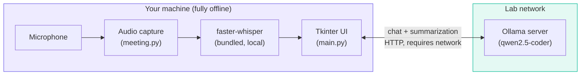
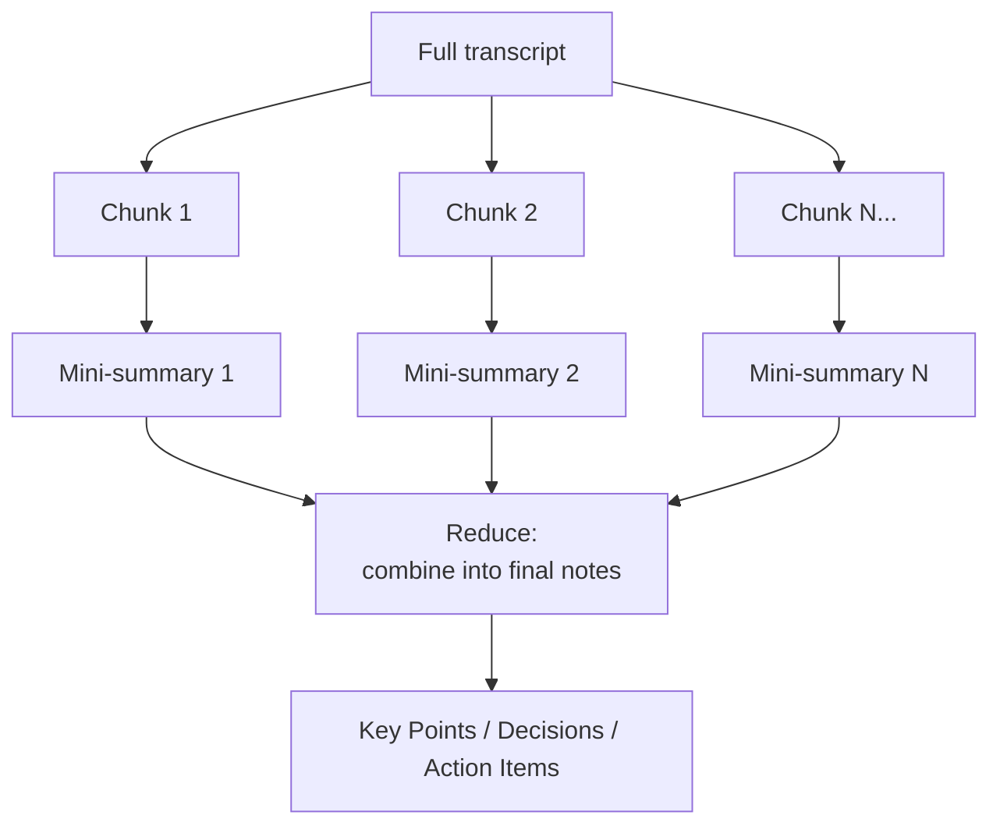

# Architecture

This page is for anyone maintaining, extending, or just curious about how the app is built. It documents not just *what* the system does, but *why* it's built this way — several design choices here came from things that didn't work in earlier iterations.

## System overview

Two AI workloads, running in two different places:

**Speech-to-text never leaves the machine.** Audio is captured, transcribed, and discarded locally — this is a deliberate privacy property, not an implementation detail. Only text (chat messages, transcripts being summarized) goes over the network, to the lab's own Ollama server.

## Module layout

| File | Responsibility |
|---|---|
| `main.py` | The Tkinter UI (`ChatApp`), configuration/settings persistence, chat networking (`query_ollama_stream`), and the map-reduce summarization logic. |
| `meeting.py` | Everything audio: device enumeration, recording (`AudioRecorder`), and the record-then-transcribe orchestrator (`MeetingSession`). No UI code and no dependency on `main.py`. |
| `theme.py` | Centralized color palette and `ttk.Style` configuration — the single source of truth for the app's visual design. |
| `agent.py` | The coding-agent tool-calling loop (`AgentSession`), its tools (read/list/search/write/edit/run-shell), and the path-scoping security boundary (`resolve_scoped_path`). No UI code and no dependency on `main.py`, same as `meeting.py`. |
| `diarization.py` | Speaker identification (`diarize`, `assign_speakers_to_segments`) — a separate model layered on top of, not replacing, `meeting.py`'s transcription. No UI code and no dependency on `main.py` or `meeting.py`. |
| `installer.py` | A minimal, dependency-free Tkinter installer GUI, built separately from the main app (see [Packaging](development/packaging.md)). |

## Why batch transcription, not live { #why-batch-transcription }

An early version of the Meeting tab transcribed audio *while recording*, using a hand-rolled energy-threshold voice-activity detector (VAD) to chop continuous audio into utterances, transcribing each as it completed. This looked good in initial tests with clearly-paced, pause-separated speech.

Under real conditions — a person speaking quickly and continuously, the way people actually talk in meetings — it broke down in two specific ways:

1. **Fragmentation.** Natural micro-pauses (a breath, a half-second hesitation) were frequently mistaken for sentence boundaries, splitting one continuous thought into two disconnected fragments.
2. **Hallucination.** Very short, decontextualized audio clips are a known failure mode for Whisper-family models — with little context to work from, the model sometimes produced plausible-sounding but entirely fabricated text (a well-documented pattern; "Thank you for watching" on near-silent audio is a famous example of this class of error).

Tuning the VAD (longer silence thresholds, a debounce requiring sustained signal before committing to a segment, feeding the previous segment's text back in as context for the next) reduced but didn't eliminate the problem.

**The fix was architectural, not a bigger tuning pass**: record the entire meeting as one continuous buffer, and transcribe it *once*, using `faster-whisper`'s own built-in VAD filtering (`vad_filter=True`, backed by Silero VAD internally) — which is more sophisticated than the hand-rolled version, and critically, has the *entire recording's context* available when deciding where sentence boundaries actually are, rather than making that call in real time from a small rolling window.

The trade-off is explicit: no incremental transcript while recording, in exchange for a transcript that's reliably coherent. For meeting notes, that's the right trade.

## Speaker diarization: GPU-only, layered on top { #speaker-diarization }

"Identify speakers" is a second, independent model (`diarization.py`, `pyannote.audio`) layered on top of `faster-whisper`'s transcript, not a replacement for it — Whisper still does the actual speech-to-text; diarization only answers *who* was talking *when*, and the two results are merged afterward by overlapping their timestamps.

**Model choice: `pyannote/speaker-diarization-community-1`, not `-3.1`.** The more commonly-referenced `-3.1` pipeline additionally depends on a separately-gated `pyannote/segmentation-3.0` model — two Hugging Face license acceptances instead of one. The community pipeline needs only itself, has better published accuracy, and ships under an explicit CC-BY-4.0 license. Fewer gated dependencies for whoever builds this app from source, for no accuracy cost — better on every axis that mattered here.

**GPU-only, with no CPU fallback.** Unlike Whisper transcription — which already has a proven, acceptable CPU path used throughout this app — real-world CPU performance for pyannote is genuinely unpredictable across unknown lab hardware; published benchmarks and real-world reports for this class of model disagree by an order of magnitude depending on hardware. Rather than risk a lab machine hanging for minutes on what looks like a hung app, the checkbox (`meeting_identify_speakers_check` in `main.py`) starts disabled and only enables once a background-thread check (`diarization.gpu_available()`, a lazy `torch.cuda.is_available()`) confirms a usable GPU exists. This mirrors the generation-token/`root.after(0, ...)` pattern described above: the check never blocks Meeting-tab construction.

**The torchcodec workaround.** pyannote's own file-path audio loading depends on `torchcodec`, which fails to load its native DLL in this environment (a PyTorch/torchcodec build mismatch, the same category of Windows DLL friction already documented in [Packaging](development/packaging.md) for other ML dependencies). Rather than chase that DLL, `diarize()` always feeds pyannote pre-decoded audio as a `{"waveform": tensor, "sample_rate": ...}` dict — reusing `faster_whisper.audio.decode_audio()`, a dependency this app already has a working relationship with, instead of adding a second audio-decoding path. This is pyannote's own documented workaround for the same issue, not a workaround invented for this app specifically.

**Failure is graceful, not fatal.** A transcription failure is a hard error (`MeetingSession.on_error`) — there's no usable output without it. A diarization failure is different: `_transcribe_with_optional_diarization()` catches any exception from the diarization step and falls back to the plain, unlabeled transcript, surfacing only a status message. Losing speaker labels on an otherwise-successful transcription shouldn't cost the user their meeting notes.

**Segment-to-speaker alignment picks the best overlap, not the first match.** `assign_speakers_to_segments()` compares each Whisper segment against every diarization turn and assigns whichever turn overlaps it *most*, not whichever comes first — a segment spanning a speaker change is common (Whisper and pyannote don't segment identically), and majority overlap is a better signal than segment order. Consecutive segments assigned to the same speaker are merged into one line, so one person's several short Whisper segments don't produce a wall of repeated labels. A segment with no overlapping turn at all (silence, an edge case near a boundary) is labeled "Unknown" rather than guessed.

## Summarization: map-reduce, not refine { #summarization }

A 60-minute meeting can produce a transcript well beyond what's comfortable to summarize in a single model call, and naive approaches to handling that have a specific, easy-to-miss failure mode worth documenting.

**Refine-style summarization** — repeatedly updating one running summary as new transcript arrives — has a well-known problem: each pass is dominated by whatever's newest, and details from early in the source material get diluted through repeated summarize-of-a-summary passes. Over many iterations, early decisions and action items can quietly disappear.

This app uses **map-reduce** instead:

1. **Map**: the transcript is split into chunks (by sentence boundaries, targeting ~4000 characters each). Each chunk is summarized *independently* into a compact, stateless bullet-point mini-summary. A garbled or unusual chunk only pollutes its own mini-summary, not the whole document.
2. **Reduce**: all the mini-summaries (not the raw transcript) are combined into one final structured-notes pass. Since inputs here are already-compact summaries, this stays cheap even for very long meetings — a dozen chunk-summaries is a trivial amount of text against the model's context window, regardless of how long the original meeting was.

Short transcripts that fit in a single chunk skip the map step entirely and go straight to the reduce prompt on the raw text — no unnecessary complexity for the common case.

## Concurrency model

The UI runs on Tkinter's single main thread, as it must. Every potentially slow operation — model loading, transcription, network requests to the AI server — runs on a background `threading.Thread`, with results marshaled back to the main thread via `root.after(0, ...)`, which is the only thread-safe way to touch Tkinter widgets from outside the main thread.

A recurring pattern throughout the codebase is a **generation token**: an integer that's incremented every time a new operation starts (a new chat message sent, a new recording started, a new summarization triggered). Callbacks from a background thread check their captured token against the current one before touching the UI — if they don't match, a newer operation has superseded this one, and the stale callback is silently discarded. This is what makes "click Stop then immediately click Record again" or "start a new chat while a reply is still streaming" safe, without needing to actually cancel in-flight network requests or threads.

## Agent: approval-gated tool calling { #agent-tool-calling }

The Agent tab is built on Ollama's OpenAI-style tool calling: `AgentSession` sends the running conversation plus a list of tool schemas to `/api/chat`, the model responds with either plain text (done) or a `tool_calls` list naming a function and its arguments, `agent.py` executes the requested tool and feeds the result back as a `role: "tool"` message, and the cycle repeats until the model stops asking for tools or a hard iteration cap (`MAX_ITERATIONS = 20`) is hit. Planning and Auto mode share this one loop — they only differ in what happens when the model asks to change something.

**Every mutating action is approval-gated, with no "fully autonomous" option**, for two reasons specific to this app's context: it's meant to be usable by people with no coding background who can't be expected to review code well enough to trust a model's judgment about when something is safe, and this project's own earlier attempt at unattended LLM-driven coding (`aider`, documented in [Development](development/contributing.md)) hallucinated non-existent APIs when left to work without tight, continuous supervision — a smaller local model making autonomous multi-step decisions on someone's actual files is exactly the failure mode to design against, not just a hypothetical risk.

- **Planning mode** lets the model use read-only tools freely, but a proposed `write_file`/`edit_file` call is only ever turned into a diff for display — the file is never touched. This is implemented as a genuine interception, not a UI-layer suggestion: the write path is never called.
- **Auto mode** runs the same loop, but a mutating tool call blocks the background thread on a `threading.Event` and shows the user the exact diff or shell command before it can proceed — reusing the same `root.after(0, ...)` + token-check pattern described above, so the Tk main loop is never touched while waiting. A rejection is fed back to the model as a tool result explaining the change was declined, so it adapts instead of silently retrying the same thing.

**The project-folder boundary is enforced structurally, not just suggested to the model.** Every file tool routes through `resolve_scoped_path`, which rejects absolute paths outright and resolves symlinks before checking containment (`os.path.realpath` + `os.path.commonpath`, not a `startswith` check, which has a well-known prefix bug). This means a malicious or simply mistaken tool call — asking to read `../../something` — is blocked before it reaches the filesystem, regardless of what mode the session is in or whether the user would have approved it. `run_shell_command` is the one exception this boundary can't fully cover: a shell command can `cd` or use absolute paths internally no matter what `cwd` it's given, which is exactly why that tool is Auto-mode-only and its safety comes entirely from mandatory human approval of the literal command string, not from path scoping.

## Packaging

See [Building from Source](development/building.md) and [Packaging & Distribution](development/packaging.md) for how the app is turned into a distributable installer, including why the speech model is bundled offline and how GPU/CPU fallback is made robust across unknown lab hardware.
