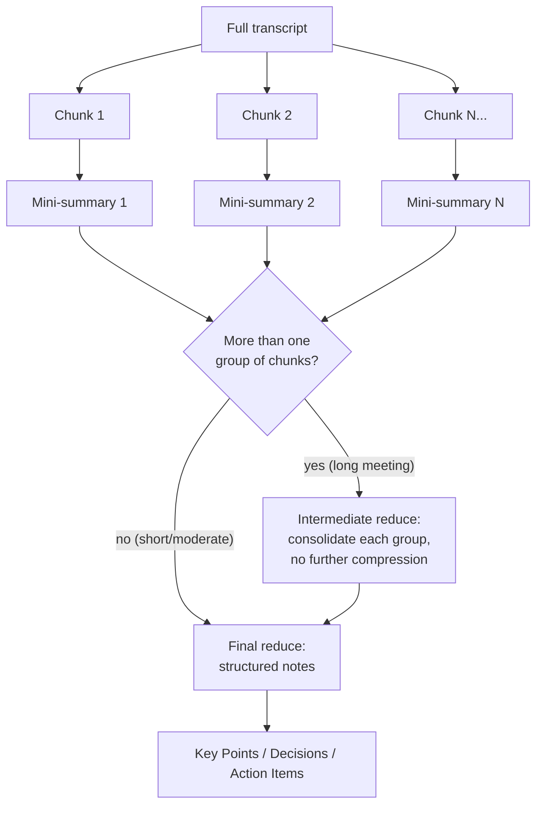

# Architecture

This page is for anyone maintaining, extending, or just curious about how the app is built. It documents not just *what* the system does, but *why* it's built this way — several design choices here came from things that didn't work in earlier iterations.

## System overview

Two AI workloads, running in two different places:

**Speech-to-text never leaves the machine.** Audio is captured, transcribed, and discarded locally — this is a deliberate privacy property, not an implementation detail. Only text (chat messages, transcripts being summarized) goes over the network, to the lab's own Ollama server.

## Module layout

| File | Responsibility |
|---|---|
| `main.py` | The Tkinter UI (`ChatApp`), configuration/settings persistence, chat networking (`query_ollama_stream`), and the map-reduce summarization logic. |
| `meeting.py` | Everything audio: device enumeration, recording (`AudioRecorder`), and the record-then-transcribe orchestrator (`MeetingSession`). No UI code and no dependency on `main.py`. |
| `theme.py` | Centralized color palette and `ttk.Style` configuration — the single source of truth for the app's visual design. |
| `agent.py` | The coding-agent tool-calling loop (`AgentSession`), its tools (read/list/search/write/edit/run-shell), and the path-scoping security boundary (`resolve_scoped_path`). No UI code and no dependency on `main.py`, same as `meeting.py`. |
| `diarization.py` | Speaker identification (`diarize`, `assign_speakers_to_segments`) — a separate model layered on top of, not replacing, `meeting.py`'s transcription. No UI code and no dependency on `main.py` or `meeting.py`. |
| `wiki.py` | Lookup tool for the lab's internal MediaWiki (`fetch_wiki_page`). No UI code and no dependency on `main.py`. |
| `websearch.py` | Lookup tool for public web search via a local SearXNG instance (`search_web`). Same shape and independence as `wiki.py` — see [Web search](#web-search). |
| `installer.py` | A minimal, dependency-free Tkinter installer GUI, built separately from the main app (see [Packaging](development/packaging.md)). |

## Why batch transcription, not live { #why-batch-transcription }

An early version of the Meeting tab transcribed audio *while recording*, using a hand-rolled energy-threshold voice-activity detector (VAD) to chop continuous audio into utterances, transcribing each as it completed. This looked good in initial tests with clearly-paced, pause-separated speech.

Under real conditions — a person speaking quickly and continuously, the way people actually talk in meetings — it broke down in two specific ways:

1. **Fragmentation.** Natural micro-pauses (a breath, a half-second hesitation) were frequently mistaken for sentence boundaries, splitting one continuous thought into two disconnected fragments.
2. **Hallucination.** Very short, decontextualized audio clips are a known failure mode for Whisper-family models — with little context to work from, the model sometimes produced plausible-sounding but entirely fabricated text (a well-documented pattern; "Thank you for watching" on near-silent audio is a famous example of this class of error).

Tuning the VAD (longer silence thresholds, a debounce requiring sustained signal before committing to a segment, feeding the previous segment's text back in as context for the next) reduced but didn't eliminate the problem.

**The fix was architectural, not a bigger tuning pass**: record the entire meeting as one continuous buffer, and transcribe it *once*, using `faster-whisper`'s own built-in VAD filtering (`vad_filter=True`, backed by Silero VAD internally) — which is more sophisticated than the hand-rolled version, and critically, has the *entire recording's context* available when deciding where sentence boundaries actually are, rather than making that call in real time from a small rolling window.

The trade-off is explicit: no incremental transcript while recording, in exchange for a transcript that's reliably coherent. For meeting notes, that's the right trade.

## Speaker diarization: GPU-only, layered on top { #speaker-diarization }

"Identify speakers" is a second, independent model (`diarization.py`, `pyannote.audio`) layered on top of `faster-whisper`'s transcript, not a replacement for it — Whisper still does the actual speech-to-text; diarization only answers *who* was talking *when*, and the two results are merged afterward by overlapping their timestamps.

**Model choice: `pyannote/speaker-diarization-community-1`, not `-3.1`.** The more commonly-referenced `-3.1` pipeline additionally depends on a separately-gated `pyannote/segmentation-3.0` model — two Hugging Face license acceptances instead of one. The community pipeline needs only itself, has better published accuracy, and ships under an explicit CC-BY-4.0 license. Fewer gated dependencies for whoever builds this app from source, for no accuracy cost — better on every axis that mattered here.

**GPU-only, with no CPU fallback.** Unlike Whisper transcription — which already has a proven, acceptable CPU path used throughout this app — real-world CPU performance for pyannote is genuinely unpredictable across unknown lab hardware; published benchmarks and real-world reports for this class of model disagree by an order of magnitude depending on hardware. Rather than risk a lab machine hanging for minutes on what looks like a hung app, the checkbox (`meeting_identify_speakers_check` in `main.py`) starts disabled and only enables once a background-thread check (`diarization.gpu_available()`, a lazy `torch.cuda.is_available()`) confirms a usable GPU exists. This mirrors the generation-token/`root.after(0, ...)` pattern described above: the check never blocks Meeting-tab construction.

**The torchcodec workaround.** pyannote's own file-path audio loading depends on `torchcodec`, which fails to load its native DLL in this environment (a PyTorch/torchcodec build mismatch, the same category of Windows DLL friction already documented in [Packaging](development/packaging.md) for other ML dependencies). Rather than chase that DLL, `diarize()` always feeds pyannote pre-decoded audio as a `{"waveform": tensor, "sample_rate": ...}` dict — reusing `faster_whisper.audio.decode_audio()`, a dependency this app already has a working relationship with, instead of adding a second audio-decoding path. This is pyannote's own documented workaround for the same issue, not a workaround invented for this app specifically.

**Failure is graceful, not fatal.** A transcription failure is a hard error (`MeetingSession.on_error`) — there's no usable output without it. A diarization failure is different: `_transcribe_with_optional_diarization()` catches any exception from the diarization step and falls back to the plain, unlabeled transcript, surfacing only a status message. Losing speaker labels on an otherwise-successful transcription shouldn't cost the user their meeting notes.

**Segment-to-speaker alignment picks the best overlap, not the first match.** `assign_speakers_to_segments()` compares each Whisper segment against every diarization turn and assigns whichever turn overlaps it *most*, not whichever comes first — a segment spanning a speaker change is common (Whisper and pyannote don't segment identically), and majority overlap is a better signal than segment order. Consecutive segments assigned to the same speaker are merged into one line, so one person's several short Whisper segments don't produce a wall of repeated labels. A segment with no overlapping turn at all (silence, an edge case near a boundary) is labeled "Unknown" rather than guessed.

## Summarization: map-reduce, not refine { #summarization }

A 60-minute meeting can produce a transcript well beyond what's comfortable to summarize in a single model call, and naive approaches to handling that have a specific, easy-to-miss failure mode worth documenting.

**Refine-style summarization** — repeatedly updating one running summary as new transcript arrives — has a well-known problem: each pass is dominated by whatever's newest, and details from early in the source material get diluted through repeated summarize-of-a-summary passes. Over many iterations, early decisions and action items can quietly disappear.

This app uses **map-reduce** instead:

1. **Map**: the transcript is split into chunks (by sentence boundaries, targeting ~4000 characters each). Each chunk is summarized *independently* into a compact, stateless bullet-point mini-summary. A garbled or unusual chunk only pollutes its own mini-summary, not the whole document.
2. **Reduce**: the mini-summaries (not the raw transcript) are combined into one final structured-notes pass.

Short transcripts that fit in a single chunk skip the map step entirely and go straight to the reduce prompt on the raw text — no unnecessary complexity for the common case.

### Why a hierarchical reduce for long meetings { #hierarchical-reduce }

The original assumption here was that combining mini-summaries is always cheap — a dozen chunk-summaries is a trivial amount of text against the model's context window, so a single reduce call should be able to just handle it. That assumption was directly measured and found wrong: for a genuinely long meeting (a real ~90-minute lab meeting, 89,900 characters, splitting into 23 chunks), the combined chunk-summaries totaled only ~4,950 tokens — comfortably under the model's 16,384-token context window — yet a single reduce call over all 23 still produced a summary that covered only the first ~40% of the meeting, silently dropping entire topics from the back half. This is a real behavior of long, open-ended single-pass synthesis (a known LLM tendency to underweight later items in a long unstructured list), not a token-budget problem — increasing `num_ctx` alone does not fix it.

The fix, validated the same way (measured on the same real transcript, not assumed): once there's more than one group of chunks (`group_items()`, default group size 6), each group first goes through an **intermediate reduce** that explicitly consolidates without compressing further — merge and de-duplicate, but don't shorten. Only the resulting (few) group-summaries go into the final structuring pass, which is also told explicitly how many parts there are and instructed to make sure every part with real content is represented, not just the earliest ones. On the same test transcript, this took the final summary from covering roughly 40% of the meeting to surfacing specific, previously entirely-missing content verbatim (down to exact figures mentioned in the meeting). Short and moderate meetings (one group) are unaffected — same single reduce call as before, just with the added numbering/coverage instruction.

Summarization calls also now pass `num_ctx` explicitly (`main.py`'s `SUMMARY_NUM_CTX`) rather than relying on the Ollama server's Modelfile default — not the cause of the bug above, but a real gap: behavior was previously silently dependent on server-side configuration that could change.

## Wiki lookup and web search: opt-in tools, additive not exclusive { #wiki-lookup }

The Chat tab can look up pages on the lab's internal MediaWiki (`wiki2.bio2.rwth-aachen.de`) via an opt-in **🔎 Wiki** checkbox, and separately search the public web via an opt-in **🌐 Web Search** checkbox ([below](#web-search)). Both are handled by one generalized tool-calling loop (`main.answer_with_tools`) that offers whichever tool schemas are currently checked — either, both, or neither — rather than two separate code paths. Wiki lookup was built first and originally had its own dedicated function; it was generalized once web search needed the exact same non-streaming, bounded, opt-in shape, rather than duplicating that machinery a second time.

**Why not Ollama's own hosted `web_search`/`web_fetch` tools for the wiki.** Ollama offers cloud-hosted search tools, but both route every request through `ollama.com`'s own servers — which have no path into the lab's internal network and could never reach an on-site or VPN-only wiki. Using them would have meant an external account, an API key, and a capability that structurally cannot do the one thing actually needed. `wiki.py` instead talks to the wiki directly: no cloud dependency, no account, no key, nothing that isn't already true of reaching the lab's own Ollama server.

**Non-streaming, and opt-in rather than always-on.** Regular Chat messages stream token-by-token, as they always have. Tool-calling needs `tools` on the request, and `agent.py`'s own `query_ollama_chat` already established (for the Agent tab) that reliably detecting `tool_calls` mid-stream isn't something to rely on — so a lookup-enabled turn switches to the same non-streaming request shape Agent already uses, gets its answer as one complete round trip, then reveals it all at once. Making `tools` a permanent part of every Chat request would have forced *every* message onto that non-streaming path for the sake of a capability most messages never need — so both tools are gated behind checkboxes instead, checked per-message and reset after send (like attachments, not a standing mode like Agent's Planning/Auto toggle), so only turns that actually ask for a lookup pay that cost.

**The domain boundary is structural, not a permission check.** The wiki tool builds its request from `WIKI_BASE_URL` (a fixed `http://wiki2.bio2.rwth-aachen.de/index.php/` string) plus an escaped page title the model supplies — there's no way for a page title to redirect the request to a different host, the same way `agent.resolve_scoped_path` structurally can't be escaped by a crafted file path. `http`, deliberately not `https`: the wiki's TLS certificate is issued for a different hostname than the one it's actually reached at, so forcing HTTPS breaks the connection outright.

**Extraction uses the standard library, not a new dependency.** MediaWiki's HTML is well-understood and stable enough that `html.parser.HTMLParser` scoped to `
` (with `mw-editsection`/`printfooter` chrome stripped, since those live *inside* that div rather than being excluded automatically like the surrounding navigation) does the job in about 60 lines — matching this project's pattern of only adding a dependency for something the standard library genuinely can't do.

**Failure is graceful, matching diarization's precedent.** A nonexistent page title (or an unreachable wiki) raises `wiki.WikiError`, which becomes the tool's result message rather than a crash — the model sees the failure and explains it in the reply, the same "degrade, don't fail hard" shape already used when a diarization run fails on an otherwise-successful transcription. `websearch.WebSearchError` follows the identical pattern for search failures.

### Web search: SearXNG on the lab network, not a cloud API { #web-search }

Unlike the wiki (internal-only, unreachable from `ollama.com`'s cloud), general web search *could* have used Ollama's hosted `web_search` tool — reaching the public internet isn't a routing problem the way reaching an internal wiki is. It was still built the same way as the wiki tool instead: `websearch.py` talks directly to a SearXNG instance running on the lab network (the same server hosting Ollama), rather than through a third-party cloud API.

**Why keep it in-house rather than use Ollama's hosted tool.** Every other network-facing part of this app either stays fully local (speech-to-text) or reaches only the lab's own infrastructure (Ollama, the wiki) — no query text has ever left the lab network by design. Routing web search through `ollama.com`'s cloud service would have been the first exception to that, sending chat query text to a third party for a capability the lab can self-host just as easily. `websearch.py` keeps that property intact: SearXNG is a metasearch engine the lab runs itself, so the app's own network boundary stays exactly where it's always been.

**This means SearXNG has to be reachable from wherever BrainLabLLM runs, not just from the server hosting it.** `SEARXNG_URL` in `websearch.py` points at the lab server's address, not `localhost` — SearXNG's own bind address has to be configured to accept connections from other lab machines (matching how the Ollama server itself is already reachable network-wide, not just locally), which is a deliberate infrastructure decision made once, not something `websearch.py` can work around on its own.

## Concurrency model

The UI runs on Tkinter's single main thread, as it must. Every potentially slow operation — model loading, transcription, network requests to the AI server — runs on a background `threading.Thread`, with results marshaled back to the main thread via `root.after(0, ...)`, which is the only thread-safe way to touch Tkinter widgets from outside the main thread.

A recurring pattern throughout the codebase is a **generation token**: an integer that's incremented every time a new operation starts (a new chat message sent, a new recording started, a new summarization triggered). Callbacks from a background thread check their captured token against the current one before touching the UI — if they don't match, a newer operation has superseded this one, and the stale callback is silently discarded. This is what makes "click Stop then immediately click Record again" or "start a new chat while a reply is still streaming" safe, without needing to actually cancel in-flight network requests or threads.

## Agent: approval-gated tool calling { #agent-tool-calling }

The Agent tab is built on Ollama's OpenAI-style tool calling: `AgentSession` sends the running conversation plus a list of tool schemas to `/api/chat`, the model responds with either plain text (done) or a `tool_calls` list naming a function and its arguments, `agent.py` executes the requested tool and feeds the result back as a `role: "tool"` message, and the cycle repeats until the model stops asking for tools or a hard iteration cap (`MAX_ITERATIONS = 20`) is hit. Planning and Auto mode share this one loop — they only differ in what happens when the model asks to change something.

**Every mutating action is approval-gated, with no "fully autonomous" option**, for two reasons specific to this app's context: it's meant to be usable by people with no coding background who can't be expected to review code well enough to trust a model's judgment about when something is safe, and this project's own earlier attempt at unattended LLM-driven coding (`aider`, documented in [Development](development/contributing.md)) hallucinated non-existent APIs when left to work without tight, continuous supervision — a smaller local model making autonomous multi-step decisions on someone's actual files is exactly the failure mode to design against, not just a hypothetical risk.

- **Planning mode** lets the model use read-only tools freely, but a proposed `write_file`/`edit_file` call is only ever turned into a diff for display — the file is never touched. This is implemented as a genuine interception, not a UI-layer suggestion: the write path is never called.
- **Auto mode** runs the same loop, but a mutating tool call blocks the background thread on a `threading.Event` and shows the user the exact diff or shell command before it can proceed — reusing the same `root.after(0, ...)` + token-check pattern described above, so the Tk main loop is never touched while waiting. A rejection is fed back to the model as a tool result explaining the change was declined, so it adapts instead of silently retrying the same thing.

**The project-folder boundary is enforced structurally, not just suggested to the model.** Every file tool routes through `resolve_scoped_path`, which rejects absolute paths outright and resolves symlinks before checking containment (`os.path.realpath` + `os.path.commonpath`, not a `startswith` check, which has a well-known prefix bug). This means a malicious or simply mistaken tool call — asking to read `../../something` — is blocked before it reaches the filesystem, regardless of what mode the session is in or whether the user would have approved it. `run_shell_command` is the one exception this boundary can't fully cover: a shell command can `cd` or use absolute paths internally no matter what `cwd` it's given, which is exactly why that tool is Auto-mode-only and its safety comes entirely from mandatory human approval of the literal command string, not from path scoping.

## Packaging

See [Building from Source](development/building.md) and [Packaging & Distribution](development/packaging.md) for how the app is turned into a distributable installer, including why the speech model is bundled offline and how GPU/CPU fallback is made robust across unknown lab hardware.
